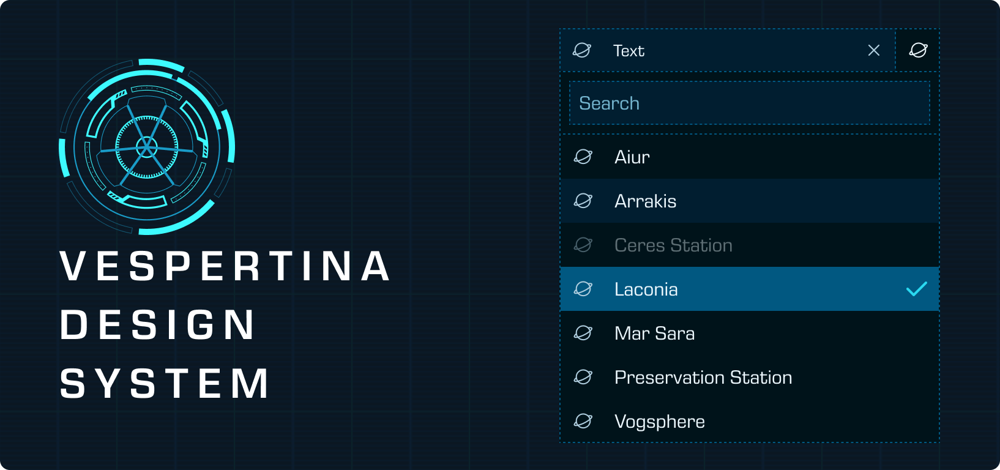

# Vespertina Design System



My personal Design System built in React + native CSS.

Design developed from scratch in [Figma](https://www.figma.com/design/jiNUbgAPy50E6CpPQEvW16/Vespertine-Cadet?node-id=377-24&t=GjcURnCKMKcftSI5-1).

## Installation

This package is available on GitHub Packages as a private package `@argousiere/vespertina-design-system`.

In your `.npmrc`, reference the registry:

```ini
@argousiere:registry=https://npm.pkg.github.com
//npm.pkg.github.com/:_authToken=${NODE_AUTH_TOKEN}
```

Install via npm:

```shell
npm install react@19 vite@7 @argousiere/vespertina-design-system
```


## Usage

In your html body or component html, add the following classes:

```html
<body class="vespertina-theme vespertina-theme--dark"></body>
```

### Import design system tokens and component library

```css
@import @argousiere/vespertina-design-system/core/tokens.css;
@import @argousiere/vespertina-design-system/core/styles.css;
```

### Import assets
```
import emptyCover from '@argousiere/vespertina-design-system/images/ves-icon-empty-cover.svg';
```

### Import React components
```ts
import { Button } from '@argousiere/vespertina-design-system/react';
```

## Development

Launch Storybook:
```shell
npm run storybook
```

Build the package into `dist/`:
```shell
npm run build
```

### Build watch
Rebuild Javascript and CSS on every change.

```shell
npm run dev:lib
```

Rebuild types

```shell
npm run build
```

## Attributions and Inspirations
- Icons from https://lucide.dev/
- Progressive Blur from https://kennethnym.com/blog/progressive-blur-in-css/
